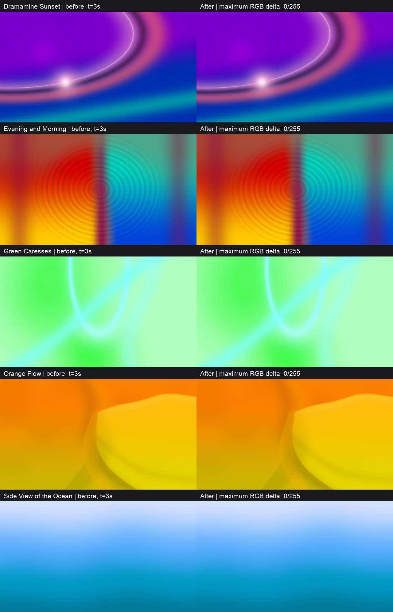

# Image-study fixes: verification

Verified on Apple M2 Pro, macOS 27.0.1. [Full measurements](verification.json) pin the baseline and the committed shader sources; the [original verification record](../image-studies-verification.json) remains evidence for its separately pinned historical revision.

All 17 signed-base squares and one fourth power now use multiplication with each base evaluated once. This avoids depending on constant-exponent optimization of Metal's default fast `pow`. Sunset's ellipse field and attached flare use the same centre and radii, its haze displacement is calculated once, and its unreachable core-blend clamp is removed. Numeric tuning, ribbon falloff, colour conversion, animation clocks, catalog membership and public shader interfaces are unchanged.

## Render comparisons

All **70 frame pairs are pixel-identical**, exceeding the planned maximum difference of 2/255 per encoded RGB channel. Each scene was compared at 1280×720 and 1032×774, at 0, 3, 10, 60 and 86,400 seconds and 0.001 seconds on each side of its first phase wrap. The wrap time is calculated from the existing `6.2831853 / phaseRate`, and the runtime uploads time as a Float.

The representative 3-second frames below are shown at half resolution; measurements use the original PNG pixels. Left is baseline, right is corrected.

Diagnostic float renders bypass both the body's final clamp/colour conversion and the fragment wrapper clamp, returning the intermediate `color` directly. All 140 renders across the same resolutions and times contain zero nonfinite RGB values, under both fast and precise math. Finite values slightly below zero or above one are expected before the unchanged final clamp.

## Compilation and publication

- All 37 Python tests pass with `HOLODECK_GPU_TESTS=1`, including the combined-recipe Metal compilation/rendering test.
- Library validation covers 65 assets and compiles all 28 snippet examples for macOS and tvOS.
- All five corrected complete shaders compile directly for both platforms. Catalog validation checks all 23 scenes, preview fingerprints, PNG hashes and tvOS compilation.
- All 23 preview PNG files remain byte-identical; the five changed bodies have updated source fingerprints. Every unaffected body, metadata file and fingerprint, all shared sources, recipes, reference originals, index entries and the preview renderer remain byte-identical to baseline.
- The original verification record retains every measurement, observation, image reference, date and limitation. Its pinned commit and every referenced scene/shared source resolve in Git. The new record identifies the committed implementation instead of duplicating derived names, hashes or per-scene reuse metadata.

## Playback and performance

The exact corrected sources were loaded into the existing Debug HolodeckMac through an offline catalog fixture and in-memory preferences. All five scenes were selected and inspected during active playback, including Sunset's attached flare, Evening and Morning's ripples, Green Caresses' cyan folds, Orange Flow's sheets and Ocean's diffuse currents. Concurrent native UI tests restarted the standard app during inspection, so the final Ocean check used an isolated copy of the same Debug build with a separate bundle identifier and local ad-hoc signature; application logic and shader sources were unchanged.

Paired offscreen GPU measurements alternate baseline and corrected 4K renders at 3 seconds, after 10 warmup pairs and over 60 measured pairs. Values exclude compilation, CPU submission, readback and presentation. The standard playback app was closed before timing, but a concurrent Holodeck native UI test run was discovered afterward. Background activity was not controlled; adjacent paired measurements compare this patch, while absolute timings should not be treated as isolated GPU performance.

| Scene | Before median (ms) | After median (ms) | Median change |
| --- | ---: | ---: | ---: |
| Dramamine Sunset | 0.588 | 0.580 | −1.36% |
| Evening and Morning | 1.137 | 1.137 | 0.00% |
| Green Caresses | 0.952 | 0.952 | 0.00% |
| Orange Flow | 1.237 | 1.248 | +0.89% |
| Side View of the Ocean | 0.631 | 0.632 | +0.16% |

No median increase reaches the 5% investigation threshold. These measurements describe this device and offscreen workload, not sustained app frame pacing.

Existing Glowing Ribbons and canonical Value Noise assets remain reused. Physical Apple TV playback/performance, minimum supported OS versions, TV/HDR colour appearance, sustained frame pacing/thermal performance and continuous day-long playback remain unverified. One-day timestamps are sampled checks.
