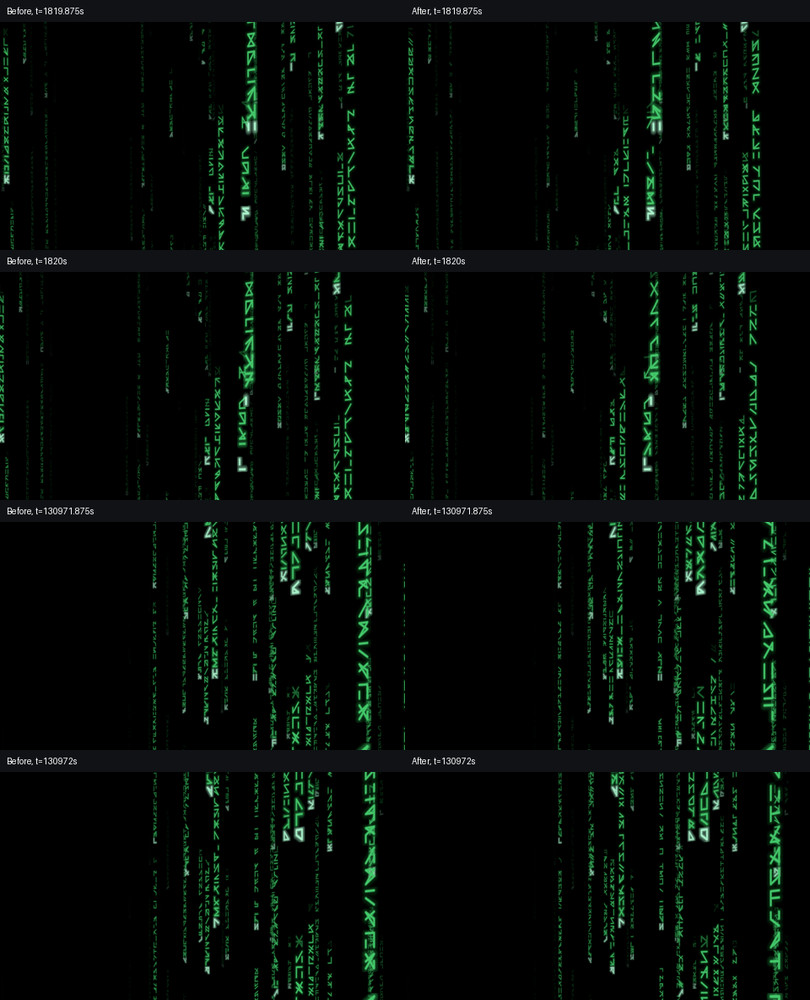
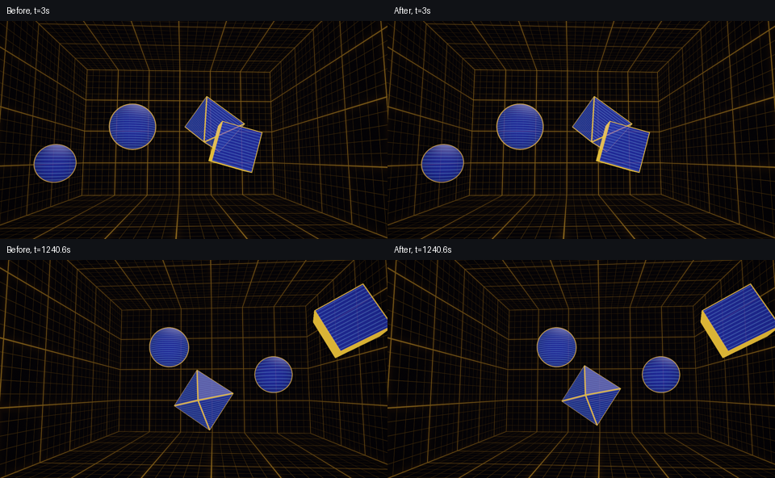

# License and shader correctness verification

Verified locally on 2026-10-10 against baseline `e5bb6270486230ed8879d9dcdba3e0203576a770`. The final working-tree sources and measurements are identified by SHA-256 in [verification.json](verification.json). Historical verification reports are preserved.

## Changes and reused assets

Complete David Hoskins MIT notices now accompany canonical `hash21` and standalone hash adaptations in Matrix Corridor, Fireworks, Ember Drift, Sunlit Shallows, Voronoi, Rune Glyph and Ember Sparks. Existing MIT and CC notices remain. The notice was checked against [David A Roberts' pinned WGSL port](https://gist.github.com/davidar/5f9677a0ccfbd63d7a8657ad9af3a856/f3619046080c1f8ff07c54f6658ed215ef5f9638); no port implementation was imported. [Hoskins provenance and notice](../../references/hoskins-hash/README.md) record the original Shadertoy URL and this evidence.

Dot Curtain now carries both Inferno's MIT notice and the gl-transitions contributors' MIT notice, with bobylito attribution. [PolkaDotsCurtain and its license](../../references/gl-transitions-polka/README.md) are preserved from gl-transitions commit `b2dfdcfbec079af4a05306d32b9366aa495c5155`. All 19 existing reference-original files retain their baseline hashes. CRT Overlay and Color Ramps notices sit above the function documentation. Value Noise and FBM provenance identifies the canonical Hoskins hash they use.

License tests deliberately register 78 source paths and 11 upstream requirements. They require exact inventory coverage, check all complete MIT blocks and canonical CC URIs, and check both independent sources and inherited example/publication assemblies. Fixtures reject new MIT/CC assets, missing or stale source records, missing secondary/shared/body notices and missing CC URIs. Enforcement remains test-only; normal library and publication validators are unchanged. `reuse` links remain informational.

Matrix Corridor retains its camera route clock and Rune Glyph lineage. Its independent glyph phase wraps at 131072 seconds, and integer rate steps preserve the modulo-4096 seed sequence. Rune Glyph's example wraps its 1.5 Hz timer at 8192 seconds. Holodeck Grid retains the Box Room geometry and hologram composition; the octahedron's authored Y lane is 3.65, and nonpositive contained extents skip the object before bouncing. The Box Room helper documents its positive-extent precondition.

Catalog selection, shader entry points and the 16-byte uniform layout are preserved. No app timing redesign or publication action was performed.

## Checks

- All 46 Python tests pass with `HOLODECK_GPU_TESTS=1` on Apple M2 Pro.
- Library validation passes for 67 assets; all 28 examples compile for macOS and tvOS. All 23 complete publication sources compile for both platforms with Xcode 27.0 / SDKs 27.0, on macOS 27.0.1 (26A434).
- The actual Matrix Metal helper matches an independent, unbounded double-precision oracle for 196,000 cases: all 80 rates, route and glyph wraps through one year, and adjacent float inputs around 32,000 seed transitions. The oracle models the incoming float and its `+100` addition, rather than assuming a precise real-valued clock.
- All 12 Holodeck lane axes satisfy positive extent, start containment and bounding-radius clearance. GPU fixtures cover zero/negative authored and available extents. A sentinel immediately before the actual bounce call remains unreachable, and renders equal independently removing the object. Removing the real guard makes all four invalid-extent fixtures fail.
- Raw float renders contain no nonfinite values at 14 timestamps per scene, including wraps, 20/78 days and one year.
- All 23 previews/fingerprints were regenerated and publication validation passes locally. The 21 scenes with notice-only changes have identical executable tokens and exact preview PNG bytes. All 27 examples with notice-only changes also preserve tokens and pixels at t=3; Rune Glyph's functional timer change was sampled separately around 8192 seconds.

Representative 1280×720 renders compare both scenes with the baseline. Matrix's four consecutive 0.125-second frame differences are similar around each wrap; they provide sampled visual evidence, not a proof of continuous playback. Holodeck's smaller Y extent changes the octahedron's long-term path as expected.

The actual macOS app was inspected with exact assembled sources and diagnostic entries whose fragment wrappers add offsets of 1815, 130967 and 1728000 seconds for Matrix, and 1240 seconds for Holodeck. The fixture uses isolated, in-memory preferences and live Metal compilation. Camera/rain motion and hologram motion remained visible across successive observations, including the wrap offsets. Diagnostic offsets do not simulate elapsed continuous uptime.

Paired 3840×2160 offscreen GPU timings use ten warmup pairs and 60 measured pairs at t=3, 1820, 130972 and 1728000. Final medians span 3.464–4.133 ms for Matrix and 1.131–1.173 ms for Holodeck on Apple M2 Pro. Per-sample medians and 95th percentiles are in the JSON record. These timings exclude presentation and do not establish sustained frame rate or Apple TV performance.

## Arithmetic findings and limits

Boundary tests exposed premature seed changes in a direct float `floor(fraction * rateSteps)`: multiplication can round up just before an integer. The final helper evaluates that same mathematical floor exactly using the float significand and a 31-bit integer product. The initially planned float product failed 1,107 of 96,000 adjacent-boundary cases; the corrected helper passes them all.

Ordinary rate rounding changes physical glyph rates by at most 1/64 Hz. Clamping very slow rates to the minimum one step can change them by up to 1/32 Hz, correcting the plan's minimum-rate assumption. Leading glyphs remain at 16 steps.

Bounded arithmetic cannot recover precision lost in the incoming float clock: its spacing is 0.125 seconds at 20 days, 0.5 seconds at 78 days and 2 seconds at one year. Arithmetic correctness for those float inputs does not establish smooth motion at those uptimes. Physical Apple TV, minimum-OS compatibility, continuous long-duration playback and sustained app frame rate remain unverified. The original Hoskins Shadertoy page was unavailable to automated retrieval; the pinned port supplied the notice evidence.
