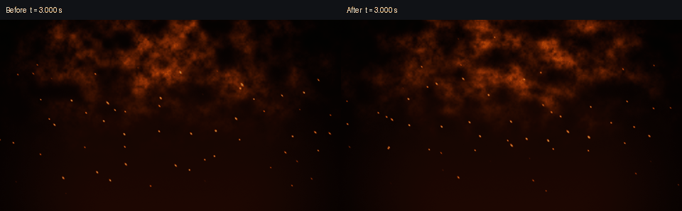
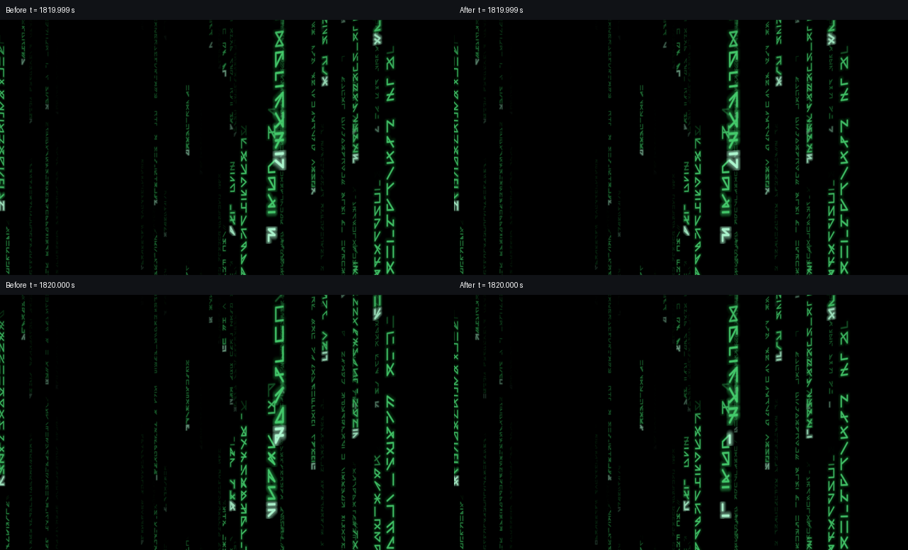
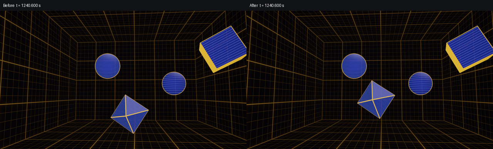

# PR #4 fixes: verification

Verified on Apple M2 Pro, macOS 27.0.1. The fixes are on PR #5's branch; its five new shaders, the original eight scenes, catalog ordering, shared runtime files and preserved reference originals are unchanged. [Full measurements and source hashes](verification.json) identify the baseline and implementation commits.

All 37 Python tests pass with `HOLODECK_GPU_TESTS=1`, including the combined-recipe compilation/rendering test. Library validation covers 65 authoring assets and compiles all 28 recipe examples for macOS and tvOS. All ten PR #4 complete sources compile for both platforms; catalog validation checks all 23 published scenes, preview fingerprints, PNG hashes and tvOS compilation.

The license regression tests fail in 33 cases before the notices are added, then pass against the complete preserved upstream MIT notices and canonical CC license URIs. Assembled publication artifacts also carry the notices. Notice-only edits preserve executable tokens and every preview PNG byte.

## Ember motion

At 1280×720, bright spark cores move from approximately 11–12 pixels downward to 12–13 pixels upward between 3 and 3.25 seconds, in both the complete scene and the recipe example. The 7,680-second boundary remains continuous: its mean maximum-channel change is 0.025/255 across the sampled millisecond. Horizontal drift, spin, flutter and fade remain active.

## Matrix boundary

At the first route wrap (1,820 seconds), pixels changing by more than 20/255 drop from 55,024 to 6,467; mean maximum-channel change drops from 5.076 to 0.934/255. At 3,740 seconds, the corrected mean is 0.711/255. Ordinary discrete rune updates continue across both boundaries. Camera and rain positions repeat every 1,920 seconds; the complete glyph animation uses an independent clock.

## Room clearance

The octahedron's vertical lane half-extent is 3.6591. Bounding-radius clearance is at least 0.05 world units for every object. An independent rotated-vertex sweep over one day at 0.1-second intervals finds a minimum actual clearance of 0.1163. Known problem timestamps at 40.6, 640.6, 1,240.6 and 12,440.6 seconds were rendered and inspected.

## Playback and performance

The three corrected scenes were inspected during active playback in Debug HolodeckMac using an offline fixture with their exact assembled sources and in-memory preferences. Raw RGB checks before the wrapper clamp found no NaN or infinity at 20 timestamps through one day.

Paired 4K offscreen GPU measurements alternate baseline and corrected sources at seven timestamps. Corrected medians are 3.60–3.75 ms for Ember Drift, 3.46–4.35 ms for Matrix Corridor and 1.14–2.62 ms for Holodeck Grid. Largest per-time median increases are 4.2%, 4.9% and 0.92%, respectively; there is no material systematic regression. Absolute timings differ from the earlier review, so the paired measurements isolate the patch impact.

Existing Ember Sparks, Rune Glyph and Box Room recipes were retained; required notices also accompany the other MIT/CC-derived assets listed in the verification record. Physical Apple TV playback, minimum supported OS versions, sustained app frame pacing and continuous day-long playback remain unverified.
