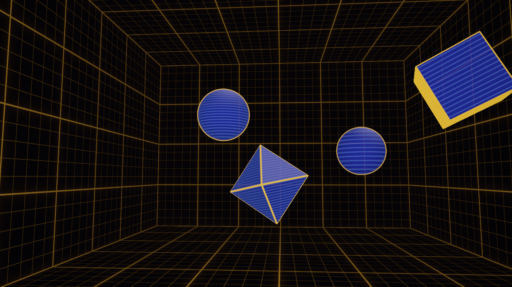

# Shader regression and renderer verification

Verified on 2026-10-11 against baseline `b1805bb77a7157a0125dd8de33e63dc6da177000`, on Apple M2 Pro with macOS 27.0.1 and Xcode/SDKs 27.0. [verification.json](verification.json) identifies the final working-tree sources and comparison artifacts by SHA-256. Previous verification reports and reference originals are preserved.

## Changes

Regression instrumentation requires exactly one matching anchor before changing source. Missing or duplicated anchors fail with their purpose and match count. Complete labels retain decimal tails in probe filenames. Class cleanup is registered before compilation, render results must contain every requested frame, and scene parsers reject unsupported declarations, malformed literals and incorrect lengths.

Holodeck Grid restores the octahedron's authored Y lane to 4.0. Its existing runtime clamp yields an effective extent of approximately 3.6591, and its guard still skips nonpositive extents before bouncing. Named constants preserve the 0.05 clearance and 1.7320508 bounding factor. Geometry tests check effective extents and start containment on all 12 axes, verify the shader expressions, and independently check the factor against sqrt(3), with a 1e-5 world-unit containment tolerance.

The preview tool and regression probe share the Metal context, 16-byte uniforms, offscreen pipeline/target, draw submission, completion checks, readback and GPU timing. PNG encoding, compute dispatch and raw-float diagnostics remain in their respective entry points. The command-line and JSON interfaces are preserved. Ordered Swift build inputs also define the preview fingerprint inputs.

Existing Box Room, Grid Lines and Hologram Rim recipes remain in use; Holodeck Scene and Starship Blueprint remain inspiration references. These recipes are original repository work, and no external implementation was copied. Catalog selection and reference originals are unchanged.

## Verification

- All 53 Python tests pass with GPU probes enabled. CPU fixtures cover missing/duplicate anchors, wrapper drift, dotted labels, setup failure cleanup, incomplete frame results, malformed scene data and stale shared-renderer fingerprints.
- The real Matrix helper still matches 196,000 independent seed-oracle cases. NaN diagnostics report 43,200 nonfinite RGB channels before the wrapper clamp and zero after it. Uniform diagnostics return the exact resolution and times 0 and 3.25 through the Metal buffer contract.
- Zero/negative authored and available extents match independently removing the object. Removing the real guard causes the comparison to fail for all four fixtures.
- Old and new renderers produce byte-identical default PNGs for all 23 published shaders using identical assembled sources. Their raw-float output also matches at 14 timestamps for each of Matrix and Holodeck, including wraps and one year. All preview fingerprints were regenerated; 22 preview PNGs remain identical to baseline, and Holodeck's preview changes with its restored lane.
- Restored Holodeck output matches the baseline source with only its authored extent restored to 4.0 and its existing guard retained, byte for byte at 0, 3, 40.6, 640.6, 1240.6, 12440.6 and 86400 seconds. The older `e5bb627` source lacks that guard and has small float-output differences at some samples (maximum absolute channel difference 0.0000492). The record distinguishes these comparisons.
- Library validation passes for 67 assets; all 28 snippet examples compile for macOS and tvOS. Holodeck's assembled source separately compiles for both platforms, and catalog validation compiles all 23 publication sources for tvOS.

Seven 1280×720 samples were rendered. Later samples and the exact assembled source were inspected in Debug HolodeckMac using its offline catalog fixture and in-memory preferences. Both normal playback and a diagnostic +1240-second offset showed animated holograms and room grids without compilation or selection errors. The offset is a source fixture, not a continuous-uptime simulation.

Physical Apple TV rendering/performance, minimum supported OS playback, continuous long-duration uptime and sustained app frame rate remain unverified. Float-clock precision at long uptime is unchanged by these fixes.
